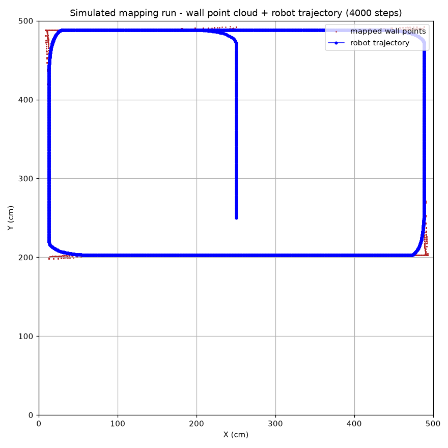
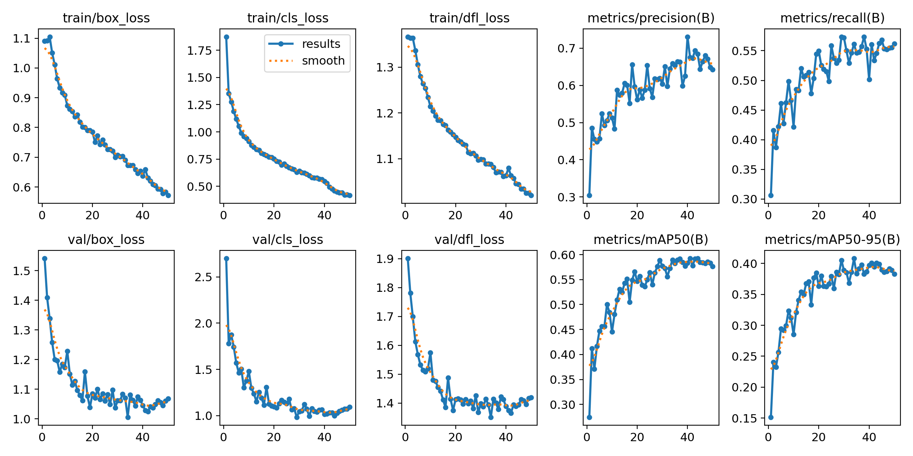
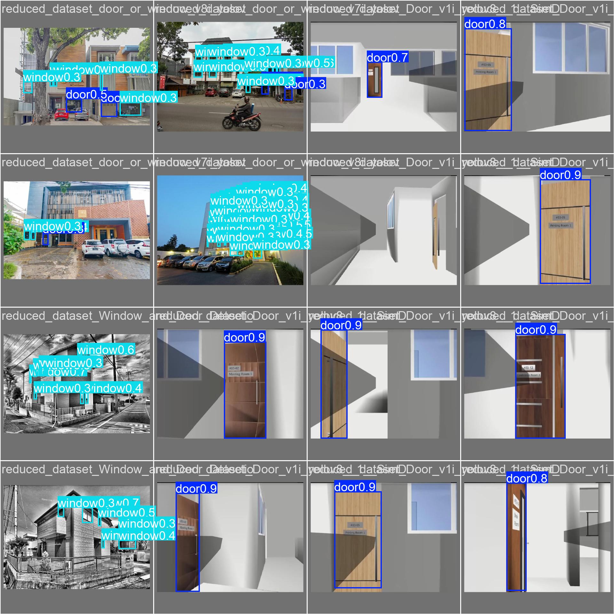

# Autonomous Indoor Mapping

[](LICENSE)

University robotics project: three related subsystems for an indoor mobile robot —
a scripted 2D mapping simulation, Arduino closed-loop odometry firmware, and a
YOLOv8 object-detection pipeline (training → NCNN export → edge inference → Flask
telemetry dashboard). The subsystems share a repo but run independently; the
README below describes what each one actually does, with its limits.


## Visual evidence


*Simulated mapping run (4000 steps of `indoor_mapping/live_slam_simulation.py`
rendered headless): the wall point cloud built by raycast scans and the robot's
coverage trajectory. Simulated — there is no physical robot or LiDAR in this repo.*

Detection assets are training outputs committed by the original runs and are
shown further down (loss curves, validation predictions, confusion matrix).

## What is and is not in this repository

| Component | Location | Status |
|---|---|---|
| 2D mapping simulation | `indoor_mapping/live_slam_simulation.py` | Works on any machine with Python + Matplotlib. A simulated robot explores a hard-coded grid room with a ray-cast distance sensor and paints an occupancy grid. **Not a SLAM algorithm**: the robot pose is ground truth from the simulator, so there is no scan matching, loop closure, or pose estimation. |
| Recorded-scan map replay | `indoor_mapping/legacy/` | Replay/plot tooling for scan logs captured during the course project (`replay_slam_from_log.py`, `create_scan_map.py`). Kept as archived code; entry points in `live_slam_simulation.py` / `show_final_map.py` are the maintained ones. |
| Odometry firmware | `odometry_code/odometry_code.ino` | 834-line Arduino sketch: encoder tick odometry, PI speed control (`KpSpeed`/`KiSpeed`), MPU6050 gyro-Z heading hold (`KpHeading`), L298N motor driver. Requires the physical robot (Arduino + L298N + optical encoders + MPU6050) to test. |
| YOLOv8 detection | `model/` | Fine-tuned YOLOv8n for 3 classes (`door`, `window`, `glass`), NCNN export for Raspberry Pi 3, inference scripts, Flask MJPEG dashboard. |

The mapping and vision pipelines were developed as one course deliverable but
were never fused into a single autonomous loop on hardware; there is no runtime
integration between the firmware and the Python side.

## Trained model results (from the committed training log)

Numbers below are read from `model/runs/detect/train/results.csv`, which was
committed together with the training run — they are reproducible by inspecting
that file, not re-verified in a fresh run.

- Config: `yolov8n.pt` init, 50 epochs, batch 16, imgsz 640, CUDA device 0 (`model/runs/detect/train/args.yaml`)
- Best mAP50 on validation: **0.592** (epoch 44)
- Final epoch (50): P = 0.643, R = 0.562, mAP50 = 0.577, mAP50-95 = 0.383

Validation sample and prediction panels from the actual run:




**The dataset itself is not in this repository.** It was assembled from a
Roboflow project (`window-and-door-detection`, see `model/master_data.yaml` and
`model/legacy_files/download_data.py`), so retraining requires downloading your
own copy of that dataset under `model/master_dataset/`. Exact retraining
numbers are not guaranteed to match.

## Installation

Prerequisites: Python 3.9+, Git. For the firmware: Arduino IDE.

```bash
git clone https://github.com/ErtugrulAK/autonomous-indoor-mapping.git
cd autonomous-indoor-mapping

python -m venv .venv

# Activate (Windows cmd)
.venv\Scripts\activate
# Activate (Windows PowerShell)
.venv\Scripts\Activate.ps1
# Activate (Linux / macOS)
source .venv/bin/activate

pip install -r requirements.txt
```

`requirements.txt` pulls PyTorch + Ultralytics + OpenCV (~2 GB with CUDA
wheels). If you only want the mapping simulation, `pip install numpy matplotlib`
is enough.

## Usage

Run the Python entry points from the **repository root** unless stated
otherwise.

```bash
# Simulated room exploration + live occupancy grid (Matplotlib window)
python indoor_mapping/live_slam_simulation.py

# Plot the recorded arena point cloud (reads arena_data.txt from cwd,
# so run from inside indoor_mapping/)
cd indoor_mapping && python show_final_map.py && cd ..
```

Vision scripts resolve model weights against the **current working directory**
(`best.pt`, `best_ncnn_model`), so run them from inside `model/`:

```bash
cd model

python detect.py          # webcam (device 0) inference with best.pt
python detect_phone.py    # phone as IP webcam (default: http://192.168.1.100:8080/video)
python export_pi.py       # re-export best.pt -> NCNN (imgsz 320, FP16)
python detect_pi.py       # NCNN-optimised inference, intended for Raspberry Pi
```

Flask telemetry dashboard (live MJPEG feed, `/detections` JSON, CPU/RAM/FPS
panels):

```bash
python model/web_dashboard/app.py     # then open http://localhost:5000
```

Firmware: open `odometry_code/odometry_code.ino` in the Arduino IDE, select the
board and COM port, upload. Pin map is at the top of the sketch (ENA/ENB PWM,
IN1-IN4 direction, encoders on INT0/INT1, MPU6050 on I2C address 0x68).

### Environment variables

The camera/dashboard scripts read plain environment variables (exported in your
shell — they are **not** auto-loaded from `.env`; see `.env.example`):

| Variable | Default | Used by |
|---|---|---|
| `CAMERA_SOURCE` | `http://192.168.1.100:8080/video` | `detect_phone.py`, `detect_pi.py`, `web_dashboard/app.py` |
| `NCNN_MODEL_PATH` | `best_ncnn_model` | `detect_pi.py` |
| `MODEL_PATH` | `model/best_ncnn_model` else `model/best.pt` | `web_dashboard/app.py` |
| `FLASK_HOST` / `FLASK_PORT` / `FLASK_DEBUG` | `0.0.0.0` / `5000` / `False` | `web_dashboard/app.py` |
| `ROBOFLOW_API_KEY` | – (required) | `legacy_files/download_data.py` |

`FLASK_HOST=0.0.0.0` exposes the dashboard to your LAN. The app has no
authentication; keep it on a trusted network or set `FLASK_HOST=127.0.0.1`.

## Reproducing the detection pipeline

1. `cd model`
2. Export your own Roboflow API key and run `python legacy_files/download_data.py`
   (dataset downloads to `master_dataset/` as expected by `master_data.yaml`).
3. `python train.py` (needs a CUDA GPU; on CPU edit `device='0'` to `device='cpu'` — see `setup_cpu.bat`).
4. Copy `runs/detect/train/weights/best.pt` to `model/best.pt`.
5. Optional NCNN export: `python export_pi.py`.

## Limitations & repo notes

- Mapping is a simulation over a hard-coded world; no LiDAR/depth sensor input path exists in the maintained scripts.
- No automated tests and no CI. Verification was manual on the course hardware.
- The repo intentionally tracks the trained weights (`best.pt`, `yolov8n.pt`, `best_ncnn_model/`, ~30 MB of blobs) so inference works out of the box; the full training run outputs under `model/runs/` (plots + `last.pt`) are also committed. If you clone just to use the code, consider a shallow clone (`git clone --depth 1`).
- `model/legacy_files/2022510022_2021510001_progress_report.pdf` is the university progress report and contains student IDs; remove it if that is undesirable for your context.
- A Roboflow API key that was hard-coded in `model/legacy_files/download_data.py` in the git history has been replaced with an environment variable. The old key was public in history — it should be rotated/deleted in Roboflow.

## Future work (not done)

- Replace the scripted simulation with real scan matching (e.g. cartographer or a hand-rolled particle filter).
- ROS 2 topics + `nav2` compatibility for the odometry firmware.
- EKF fusion of encoders, IMU and visual odometry.
- WebSocket streaming instead of HTTP polling in the dashboard.

## License

MIT — see [LICENSE](LICENSE).
